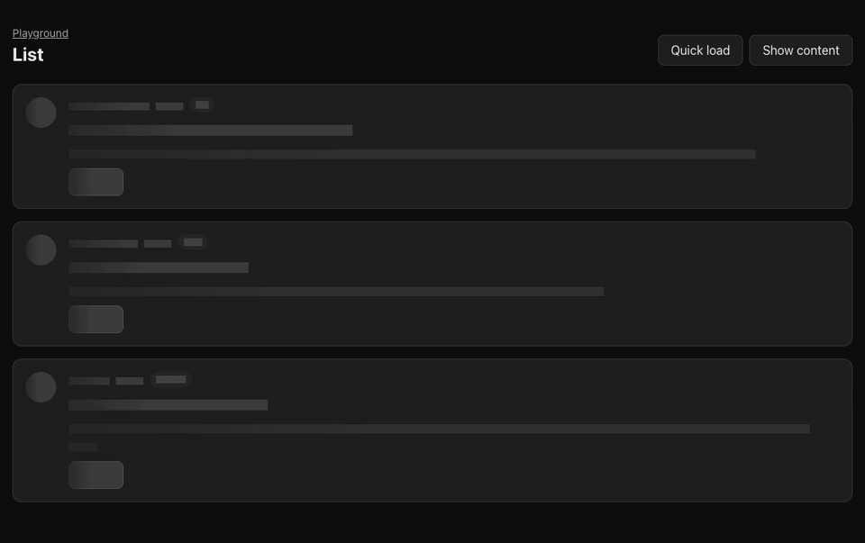
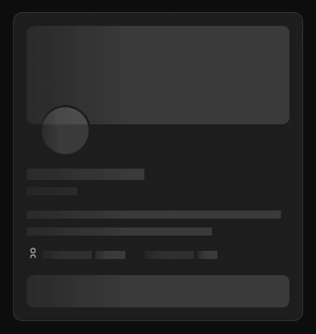
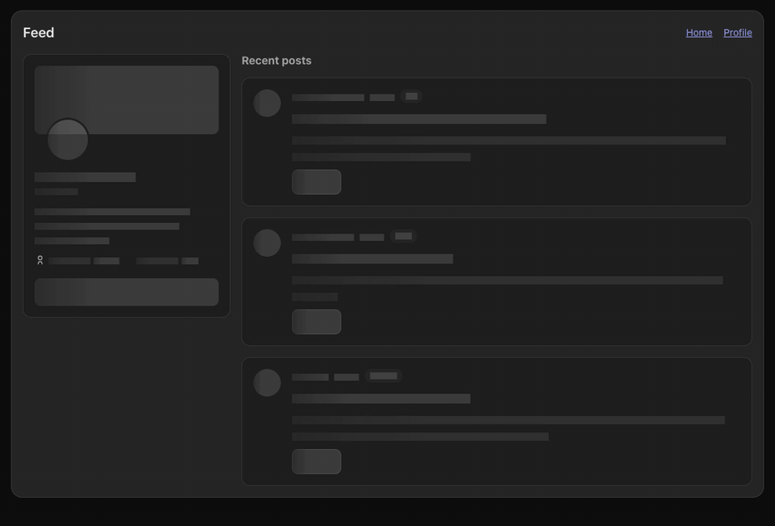
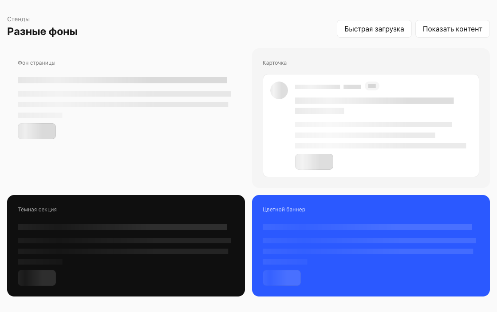

# loadshape

[English](README.md) · [Русский](README.ru.md)

**Преврати готовый React-компонент в его скелетон загрузки.**

Передай компоненту реалистичные подставные данные и оберни его в `Skeleton.Root`.
loadshape закрасит текст, медиа и элементы управления, сохранив отрисованную раскладку.
В библиотеку также входят встроенный в строку `Spinner` и неопределённый прогресс `RouteProgress`.



Запись сделана на [стенде списка](apps/playground/src/pages/ListStand/index.tsx).
В обоих состояниях используются одинаковые данные, поэтому геометрия совпадает точно.
В приложении выбирай заглушки с типичной длиной текста и резервируй размеры изображений:
библиотека не предсказывает содержимое ответа и количество строк.

[Скриншот загрузки](docs/assets/skeleton-loading.png) ·
[Скриншот контента](docs/assets/skeleton-content.png) ·
[Полный API и ограничения](packages/loadshape/README.ru.md) ·
[npm](https://www.npmjs.com/package/loadshape)

## Установка

Нужны **React 18 или 19** и браузер с поддержкой современного CSS.

```sh
npm install loadshape
```

Подключи стили один раз в точке входа приложения:

```tsx
import 'loadshape/styles.css';
```

У основного пакета нет runtime-зависимостей, кроме React как peer.
Стили находятся в `@layer loadshape`; цвета, отступы и оформление компонентов задаёт приложение.
Поддержка TanStack Router вынесена в отдельную необязательную точку входа.

## Начни с существующего компонента

```tsx
import { Skeleton } from 'loadshape';

type Post = { id: string; title: string; excerpt: string };

const PLACEHOLDER_POSTS: Post[] = [
  { id: 'placeholder-1', title: 'A typical article title', excerpt: 'A representative summary.' },
  { id: 'placeholder-2', title: 'Another article title', excerpt: 'A slightly longer summary.' },
];

export function PostList({ data, loading }: { data?: Post[]; loading: boolean }) {
  const posts = data ?? PLACEHOLDER_POSTS;

  return (
    <section aria-busy={loading || undefined}>
      <Skeleton.Root loading={loading}>
        <Skeleton.Static render={<h2 />}>Recent posts</Skeleton.Static>
        <ul>
          {posts.map((post) => (
            <li key={post.id}>
              <h3>{post.title}</h3>
              <p>{post.excerpt}</p>
            </li>
          ))}
        </ul>
      </Skeleton.Root>
    </section>
  );
}
```

Сохрани существующие ветки ошибки и пустого ответа вокруг примера. Передавай `loading` для
первой загрузки, а при фоновом обновлении сохраняй настоящий контент из кеша.
`Skeleton.Static` оставляет видимым содержимое, известное до запроса, например заголовок секции.
Ставь `aria-busy` снаружи Root, поскольку на загрузке Root получает inert.

Проп `render` применяет Root к существующему элементу, например `<ul />` или `<article />`.
[`Skeleton.Repeat`](packages/loadshape/README.ru.md#повторение-заглушек) повторяет заглушку
компонента несколько раз без дополнительной DOM-обёртки.

## Скелетоны в разных раскладках

Один и тот же Root может покрывать карточку профиля или страницу с боковой панелью и лентой.
Записи показывают переключение настоящих компонентов playground между загрузкой и контентом.

### Карточка профиля



[Исходник CardStand](apps/playground/src/pages/CardStand/index.tsx).
Компонент резервирует размеры обложки и аватара в своём CSS.

### Страница со статичным содержимым



[Исходник PageStand](apps/playground/src/pages/PageStand/index.tsx).
Навигация находится за пределами Root, а `Skeleton.Static` сохраняет заголовок ленты внутри него.

## Цвета из приложения

Skeleton наследует `currentColor`, сохраняя фоны контейнеров, рамки, отступы и SVG-иконки.
На скриншоте один механизм работает на странице, карточке, тёмной секции и цветном баннере.



Настрой [CSS-переменные](packages/loadshape/README.ru.md#css-переменные) через токены приложения.
Все три компонента по умолчанию появляются через **150 мс**, чтобы короткие запросы не вызывали
мигания загрузки. Задержка настраивается, каждый компонент учитывает reduced-motion.
Для просмотра без анимации выше доступны обычные скриншоты.

## Спиннеры в строке

Spinner наследует размер шрифта и цвет текста, поэтому подходит для кнопок, текста и разных фонов.

```tsx
import { Spinner } from 'loadshape';

export function SaveButton({ saving }: { saving: boolean }) {
  return <button disabled={saving}>{saving && <Spinner />} Save changes</button>;
}
```

Кольцо имеет размер `1em`; если ширина кнопки должна сохраняться, зарезервируй место под иконку
в её CSS. Без подписи Spinner декоративный. Для отдельного статуса используй
`<Spinner label="Loading the report" />`; особенности живых объявлений описаны в
[разделе доступности](packages/loadshape/README.ru.md#spinner).

## Прогресс навигации

RouteProgress показывает активность во время перехода. Полоса не изображает процент и скрывается
после завершения или отмены перехода.

Передай общему компоненту сигнал загрузки приложения:

```tsx
import { RouteProgress } from 'loadshape';

<RouteProgress pending={pending} className={styles.progress} />;
```

Приложение задаёт расположение, цвет и доступное сообщение о навигации.
[Адаптер TanStack Router](packages/loadshape/README.ru.md#tanstack-router) получает состояние
загрузки сам и сбрасывает задержку появления при смене адреса назначения:

```tsx
import { RouteProgress } from 'loadshape/tanstack-router';

<RouteProgress className={styles.progress} />;
```

Оставляй индикатор смонтированным в постоянной раскладке роутера. Адаптер требует необязательный
peer `@tanstack/react-router`; Skeleton, Spinner и общий RouteProgress работают без него.

## Попробуй playground

Клонируй репозиторий и используй версию pnpm, закреплённую в `package.json`:

```sh
git clone https://github.com/semyonsurkov/loadshape.git
cd loadshape
pnpm install
pnpm dev
```

Открой локальный адрес из вывода Vite. В playground есть стенды списка, карточки, страницы,
разных фонов, пограничных случаев, спиннера и навигации. Кнопки стендов переключают загрузку
и контент; навигационный стенд содержит переходы длительностью 100 и 1200 мс.

Источники и параметры записей описаны в [заметках о медиа](docs/assets/README.ru.md).

## API и границы

| Компонент                                                              | Назначение                                                  |
| ---------------------------------------------------------------------- | ----------------------------------------------------------- |
| [Skeleton.Root](packages/loadshape/README.ru.md#root-и-static)         | Закрашивает отрисованное поддерево при loading=true.        |
| [Skeleton.Static](packages/loadshape/README.ru.md#root-и-static)       | Сохраняет содержимое, известное без запроса.                |
| [Skeleton.Repeat](packages/loadshape/README.ru.md#повторение-заглушек) | Повторяет функцию отрисовки без обёртки.                    |
| [Spinner](packages/loadshape/README.ru.md#spinner)                     | Показывает активность в размере и цвете окружающего текста. |
| [RouteProgress](packages/loadshape/README.ru.md#routeprogress)         | Показывает неопределённый прогресс перехода.                |

Пакет поставляет ES modules и декларации TypeScript. CSS использует слои, `:has()`, `color-mix()`
и маски. CommonJS и устаревшие CSS-движки находятся за пределами этой версии.
Запросы, ошибки, пустые ответы и выбор заглушек под неизвестный контент остаются у приложения.
Перед подключением прочитай [полное описание совместимости и границ](packages/loadshape/README.ru.md#совместимость-и-границы).

## Скилл интеграции

Установи руководство в каталог скиллов своего агента:

```sh
npx skills add semyonsurkov/loadshape --skill loadshape -a codex -y
```

Для других агентов используй выбор в CLI. Скилл содержит примеры TanStack Query, подключения
существующих загрузчиков, Spinner и RouteProgress.

## Разработка и версии

```sh
pnpm typecheck
pnpm lint
pnpm build
pnpm exec prettier --check .
```

Доступны [документация проекта](docs/README.ru.md), [тесты](docs/testing.ru.md)
и [разработка и упаковка](docs/development.ru.md). Версии и changelog ведутся через Changesets;
изменение версии и упаковка выполняются отдельно от публикации.

Основной репозиторий находится на [GitHub](https://github.com/semyonsurkov/loadshape), зеркала на
[GitLab](https://gitlab.com/semyonsurkov/loadshape) и [GitVerse](https://gitverse.ru/semyonsurkov/loadshape).

[Лицензия MIT](LICENSE).
